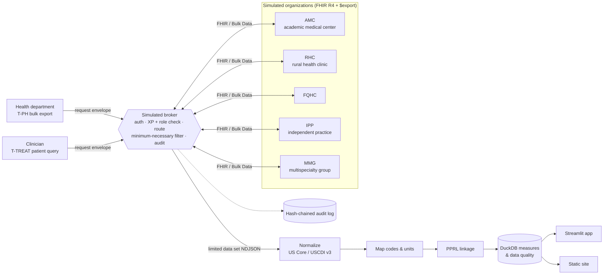

# Chronic Disease Data Exchange Lab

[](https://github.com/saikurmana/chronic-disease-exchange-lab/actions/workflows/ci.yml)

> **Independent portfolio project. Not affiliated with, endorsed by, or produced for CDC, ONC/ASTP, The Sequoia Project, or any QHIN. Not a TEFCA implementation. All data are synthetic.**
>
> Synthetic data — for demonstration only. Policy and legal content is descriptive and educational; it is **not legal advice**.

A working simulation of a chronic disease use case for nationwide health information exchange, inspired by TEFCA's **Public Health** exchange purpose. A public health agency requests standardized hypertension and diabetes data from five simulated healthcare organizations across a simulated network. It then maps local codes, deduplicates patients across organizations, and computes population measures for surveillance and program action. The repo also includes the use-case, stakeholder and protocol documentation a real program would need, written as reusable templates.

**Site:** <https://saikurmana.github.io/chronic-disease-exchange-lab/> · **App:** `make app` (Streamlit; hosted URL: `APP_URL`)

## The problem

Chronic disease surveillance often depends on surveys, claims and one-off EHR extracts. Each request has its own reporting interface, file layout and data use agreement, so providers repeat the work for every request. Patients seen at several organizations get counted twice, and local codes and units quietly fall out of the numbers. A standardized, purpose-checked network request can replace that patchwork, but only if purpose, minimum necessary, terminology, linkage and data quality are handled explicitly.

## What this demonstrates

- **Purpose-based exchange.** Requests carry a TEFCA XP code (`T-PH`, `T-TREAT`, …). The broker checks the requester's role, jurisdiction and date range and denies by default. Public Health receives a **limited data set** filtered to the use case; Treatment receives the **full record** for one patient.
- **Standards.** FHIR R4, **US Core 6.1.0** profiles, **USCDI v3** data elements, LOINC / SNOMED CT / ICD-10-CM / RxNorm codes, and a **Bulk Data v2.0.0-style `$export`** (kick-off → status → NDJSON → delete).
- **Messy realities.** Local problem codes, split vs panel BP, non-UCUM units, HbA1c in IFCC mmol/mol, free-text medications, missing race and county, batch-loading lag, duplicate interface resends, and the same people seen at several organizations.
- **Privacy-preserving record linkage.** Sources compute HMAC tokens; the health department links records without seeing names. Accuracy is scored against ground truth that is kept separately.
- **Measures.** Hypertension and diabetes prevalence, **BP control adapted from CMS165v13**, and **HbA1c >9% adapted from CMS122v13**, stratified by organization, age, sex, county and rurality. The repo also shows *network vs single-organization* views and the effect of mapping and deduplication.
- **Audit.** An append-only, SHA-256 hash-chained log records who, which purpose, what, when and the outcome of every step.

## Architecture



More detail: [docs/architecture.md](docs/architecture.md), including **how this simplifies real QHIN-to-QHIN exchange**.

## Quickstart

Requires Python 3.11.

```bash
python -m pip install -r requirements-app.txt
```

```bash
make pipeline test
```

```bash
make app
```

To host the app on Streamlit Community Cloud, set the entrypoint to `app/streamlit_app.py`. Cloud installs `app/requirements.txt`, which pins exactly the app's runtime dependencies at the same versions as `requirements-app.txt`; a test keeps the two in sync.

`make pipeline` runs `make data network exchange measures`, and takes about 1.5 minutes on a laptop. `make site` builds the static site into `_site/`. The app and the site both run offline from the committed `outputs/`.

| Target | What it does |
|---|---|
| `make data` | Generate 5,000 synthetic persons → 5,799 patient records across 5 organizations (`data/raw`, ground truth in `data/ground_truth`) |
| `make network` | Stand up the nodes in-process, health-check them, publish `outputs/network_directory.json` |
| `make exchange` | Flow A (Public Health bulk), Flow B (Treatment query), 10 refusal scenarios, normalization, mapping, linkage; writes `examples/` |
| `make measures` | Measures, strata, pipeline effects, single-org vs network, data quality → `outputs/` |
| `make test` | `ruff` + `pytest`: FHIR validation, purpose filtering, Bulk protocol, audit completeness and tamper detection, dedup accuracy, measure logic, golden regression, site, app |
| `make site` / `make app` / `make serve` | Static site · Streamlit app · broker and nodes over HTTP (`/docs`) |

## Headline results (synthetic, measurement period 2025)

Network view, full pipeline: 4,003 adults with a qualifying ambulatory visit.

| Measure | Numerator / denominator | Rate |
|---|---|---|
| Hypertension prevalence | 1,018 / 4,003 | **25.4%** |
| Diabetes prevalence | 519 / 4,003 | **13.0%** |
| BP controlled <140/90 (CMS165v13-adapted) | 500 / 830 | **60.2%** |
| HbA1c >9% or missing (CMS122v13-adapted, inverse) | 128 / 375 | **34.1%** |

What the pipeline steps change:

| Step | Persons | HTN prevalence | BP control |
|---|---|---|---|
| As received (no mapping, no dedup) | 4,990 | 21.1% | 48.6% |
| + code & unit mapping | 4,990 | 24.4% | 60.4% |
| + PPRL deduplication (full pipeline) | 4,465 | 25.4% | 60.2% |
| Perfect (ground-truth) linkage | 4,438 | 25.5% | 60.1% |
| Ground truth, latent disease incl. undiagnosed | 4,438 | 35.0% | — |

- **Deduplication:** precision **0.999**, recall **0.951** against ground truth (5,799 records → 5,034 linked persons; truth 5,000). Remaining misses are typos that change the Soundex code and day/month-swapped birth dates.
- **What exchange adds:** 19-27% of each organization's adult patients have records at another organization. For 11-19% of each organization's BP-control denominator, the most recent BP reading came from somewhere else.
- **Data quality:** the rural clinic codes only 31% of chronic diagnoses in a standard system and has a 27-day median availability lag. The independent practice sends 0% of BP values in UCUM units and only 59% of medications with RxNorm codes. The FQHC reports 60% of HbA1c results in IFCC units under a local code. All exchanged resources pass FHIR structural validation.

These numbers come from a synthetic population and say nothing about any real place.

## Example request and response

Public Health bulk export (envelope sent to the broker; full set in [`examples/`](examples/)):

```json
{
  "request_id": "req-0001-ph-bulk",
  "requester": {"id": "lkdph", "credential": "demo-credential-lkdph"},
  "purpose": "T-PH",
  "operation": "bulk-export",
  "jurisdiction": "Lakeland State",
  "date_range": {"start": "2024-01-01", "end": "2025-12-31"},
  "resource_types": ["Patient", "Encounter", "Condition", "Observation", "MedicationRequest"],
  "targets": ["*"]
}
```

A Patient as the health department receives it (limited data set: name masked, pseudonymous ID, no phone or street address, linkage tokens added; tokens abbreviated here):

```json
{"resourceType": "Patient", "id": "ph-00a3cddf958930da",
 "identifier": [{"system": ".../sid/ph-pseudonym", "value": "ph-00a3cddf958930da"}],
 "name": [{"extension": [{"url": "http://hl7.org/fhir/StructureDefinition/data-absent-reason", "valueCode": "masked"}]}],
 "gender": "male", "birthDate": "1958-09-08",
 "address": [{"city": "Ridgeview", "district": "Ridge County", "state": "LK", "postalCode": "00501", "country": "US", "use": "home"}],
 "extension": [{"url": "http://hl7.org/fhir/us/core/StructureDefinition/us-core-race", "...": "..."},
               {"url": ".../StructureDefinition/pprl-linkage-tokens", "extension": [{"url": "T1", "valueString": "efa655ab…"}]}],
 "meta": {"tag": [{"code": "synthetic", "display": "Synthetic data — for demonstration only."}],
          "security": [{"system": "http://terminology.hl7.org/CodeSystem/v3-ActReason", "code": "HTEST"}]}}
```

A refused request (a health plan asserting Public Health):

```json
{"resourceType": "OperationOutcome",
 "issue": [{"severity": "error", "code": "forbidden",
            "diagnostics": "Requester role 'HealthPlan' may not assert T-PH; requires ['PHA']"}]}
```

## Synthetic data generator

**A seeded Python FHIR R4 generator (`synth/`) produced the data, not Synthea.** Synthea was the preferred generator and was evaluated: the official jar runs under Java 21, but 200 patients took 69 s and produced 578 MB of FHIR. That works out to roughly 14 GB per 5,000-patient run, which doesn't fit a repository under 20 MB or deterministic CI. The custom generator writes exactly the resources this use case needs, injects controlled EHR "flavors", and keeps ground truth for evaluation. It is far less clinically realistic than Synthea; see [docs/limitations.md](docs/limitations.md). Every resource carries `meta.tag` "synthetic" and `meta.security` `HTEST`, and every committed data file is labeled.

## Documentation

| Document | Contents |
|---|---|
| [Use case](docs/use_case.md) | Actors, preconditions, triggers, main and alternate flows, data elements mapped to USCDI v3 / US Core 6.1.0 / code systems, measure specifications and simplifications, success criteria |
| [Stakeholder needs](docs/stakeholder_needs.md) | Framework for health departments, providers, health systems, HIEs/networks, patients/community and EHR vendors, to validate with real stakeholders |
| [Data sharing protocol](docs/data_sharing_protocol.md) | Request/response spec, purpose handling, minimum necessary, consent, security, audit, errors, versioning |
| [Policy context](docs/policy_context.md) | TEFCA and public health exchange, HIPAA public health disclosures, information blocking (cited; not legal advice) |
| [Architecture](docs/architecture.md) | Diagrams, components, and how this simplifies real exchange |
| [Limitations](docs/limitations.md) | What this does not do |
| [References](docs/references.md) | Every TEFCA, standards, measure and legal source, with URLs and access dates |

## Repository layout

```
synth/      synthetic population + per-organization EHR flavors
network/    FHIR node API, broker, exchange-purpose policy, audit log
exchange/   flows A and B, normalization, code mapping, PPRL linkage, evaluation
measures/   DuckDB measures, strata, data quality
labcore/    config, verified code constants, I/O, validation, PPRL, charts
app/        Streamlit app (+ committed demo slice in outputs/demo_network)
sitegen/    static site generator (GitHub Pages)
docs/       use case, stakeholders, protocol, policy, architecture, limitations, references
examples/   requests, responses, NDJSON, refusals, audit entries
outputs/    small deterministic results used by the app and site
tests/      pytest suite + small simulation and golden snapshot
```

## Key references

TEFCA Common Agreement v2.1; RCE Exchange Purposes SOP v5.1; XP Implementation SOP: Public Health v1.1; Facilitated FHIR Implementation SOP v2.0; FHIR Roadmap for TEFCA Exchange v2; US Core 6.1.0; USCDI v3; Bulk Data Access v2.0.0; CMS165v13; CMS122v13; 45 CFR 164.501, 164.502(b), 164.512(b), 164.514(d)-(e); 45 CFR Part 171. Full citations with URLs and access dates are in [docs/references.md](docs/references.md).

## Disclaimer

Independent portfolio project. Not affiliated with, endorsed by, or produced for CDC, ONC/ASTP, The Sequoia Project, or any QHIN. Not a TEFCA implementation. All data are synthetic. This project is not a QHIN or a TEFCA participant, and it is not certified by anyone. Nothing here is legal advice.

## Author

**Sai Kurmana, MPH, MS, CPHIMS**
