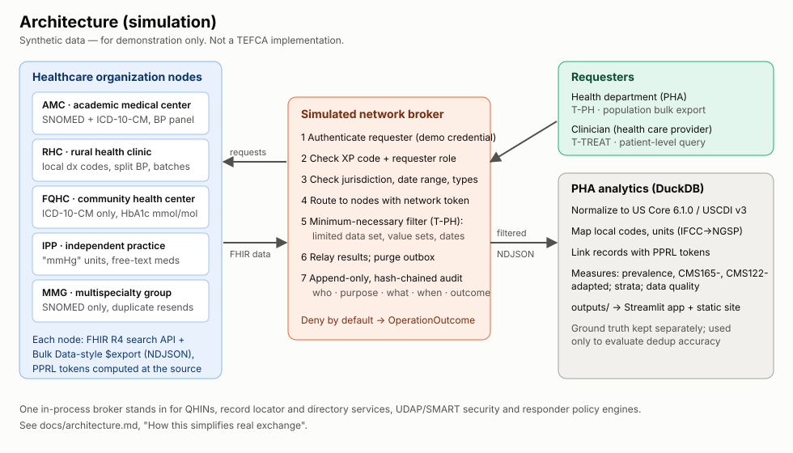
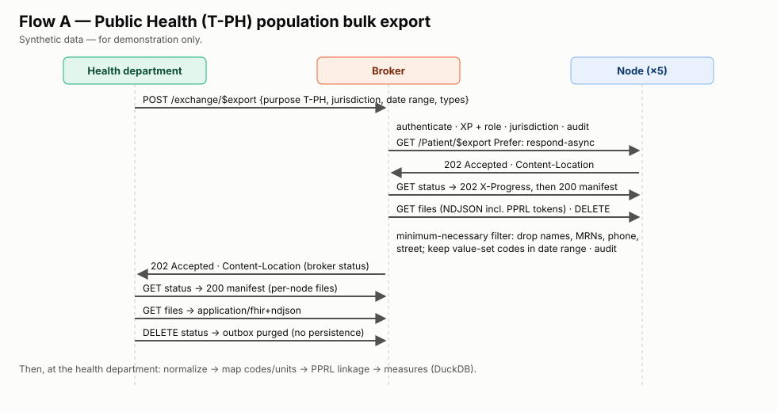

# Architecture

> Synthetic data — for demonstration only. Independent portfolio project. Not affiliated with, endorsed by, or produced for CDC, ONC/ASTP, The Sequoia Project, or any QHIN. Not a TEFCA implementation. All data are synthetic.





## Components

| Layer | Code | Responsibility |
|---|---|---|
| Synthetic population | `synth/generate.py`, `synth/orgs.py` | 5,000 persons → 5,799 patient records across 5 fictional organizations; each organization has an "EHR flavor" (coding, units, missing fields, lag, duplicates). Ground truth is written separately to `data/ground_truth/` |
| Node API | `network/node.py` (FastAPI) | FHIR R4 search by patient, demographic search, Bulk Data-style `$export` (kick-off → status → files → delete), `CapabilityStatement`. Only resources with `meta.lastUpdated` ≤ the extract date are visible. Computes PPRL tokens for `T-PH` exports |
| Broker | `network/broker.py`, `network/policy.py` | Authenticates requesters; checks XP code, role, operation, jurisdiction, date range and types; routes; applies the minimum-necessary profile; relays results; purges its outbox |
| Audit | `network/audit.py` (DuckDB) | Append-only, SHA-256 hash-chained log of every step |
| PHA pipeline | `exchange/run.py`, `normalize.py`, `linkage.py` | Flow A (bulk), Flow B (treatment query), refusal scenarios; normalization; code/unit mapping; PPRL linkage; evaluation vs ground truth (`evaluate.py`) |
| Measures | `measures/compute.py`, `data_quality.py` (DuckDB SQL) | Prevalence, CMS165v13- and CMS122v13-adapted measures, strata, pipeline effects, single-org vs network comparison, per-node data quality |
| Presentation | `app/streamlit_app.py`, `sitegen/build.py`, `labcore/charts.py` | Streamlit app and static GitHub Pages site, both built from committed `outputs/` |

## Data flow and storage

```
data/raw/<org>/<Type>.ndjson      source EHR data per organization (git-ignored, regenerated)
data/ground_truth/*.csv           persons + record links (never visible to the PHA)
data/exchange/received/...        what the PHA received (post-filter NDJSON)
data/exchange/analytic.duckdb     normalized tables (mapped/unmapped) + crosswalks
data/exchange/audit.duckdb        audit log
outputs/*.csv|json                small, deterministic, committed results
examples/                         committed request/response/NDJSON/audit examples
```

Determinism: there is one integer seed (`labcore/config.py`), per-person string-seeded RNGs, sorted NDJSON, a fixed "as-of" date, a logical audit clock, and IDs derived from hashes. Running `make pipeline` twice yields identical `outputs/` (checked in CI).

## How this simplifies real QHIN-to-QHIN exchange

| Real-world element | In this simulation | Why it matters |
|---|---|---|
| **Multiple QHINs**, each with its own Participants/Subparticipants, connected QHIN-to-QHIN ([T10]) | One in-process broker; nodes are direct children | No cross-QHIN routing, record-locator federation, or inter-network latency and failure |
| **Exchange modalities** in the QHIN Technical Framework (IHE-based QHIN Query and Message Delivery; Facilitated FHIR [T5]; FHIR roadmap stages [T6]) | FHIR REST + Bulk Data-style `$export` only | Bulk Data isn't specified for TEFCA Facilitated FHIR; it's used here to illustrate population-level retrieval |
| **Directory service** (RCE Directory, organization IDs, endpoints) | A Python dict (`Broker.directory()`) | No endpoint discovery or certificate binding |
| **Security**: certificates, UDAP dynamic registration, SMART/OAuth scopes, mTLS ([T5]) | A demo credential and an HMAC token bound to the request id | Shows *where* checks occur, not how to implement them securely |
| **Responder autonomy.** The responding organization decides what to return under applicable law; `T-PH` responses are "SHOULD", not "MUST" ([T3]) | The broker enforces one shared filter; nodes always respond | In reality minimum-necessary decisions sit mainly with the responder; intermediaries generally don't reshape payloads, and must not persist PH data ([T4] §5.4) |
| **Patient matching** across networks (demographics, IAL2 identity in some XPs) | Treatment: exact family + DOB + standardized given name. PH: PPRL tokens | Real matching is probabilistic and governed |
| **Asynchronous scale** (millions of records, retries, rate limits, `Retry-After`) | Synchronous fan-out; the second status poll completes | No back-pressure or partial-failure handling beyond logging |
| **Audit** under the QTF and SOP requirements | One hash-chained table | No distributed audit or accounting-of-disclosures workflow |
| **Fees, onboarding, designation, governance** | Out of scope | — |

## Running the network as HTTP services (optional)

`make serve` starts the broker at `http://127.0.0.1:8000` (OpenAPI docs at `/docs`) and mounts every node at `/nodes/<id>`. Direct node calls return `401` unless they carry a broker-issued token. That is by design.

[T3]: references.md
[T4]: references.md
[T5]: references.md
[T6]: references.md
[T10]: references.md
